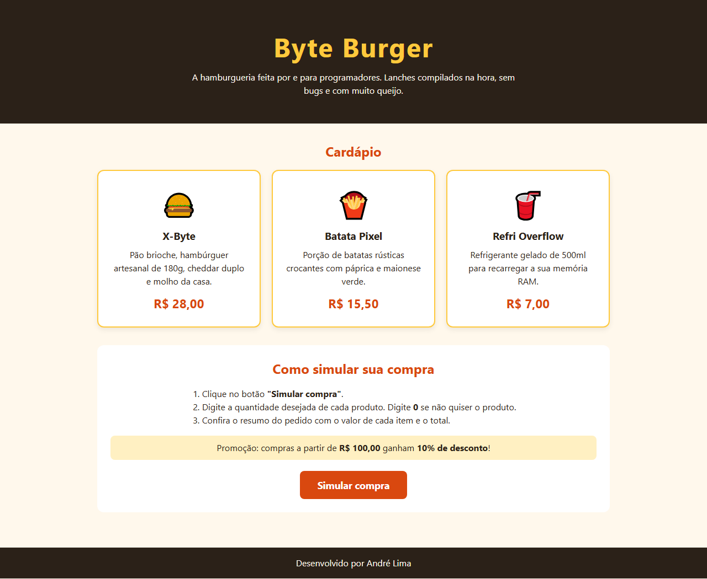

# Byte Burger — Simulador de Compras

- **Projeto:** Desafio 1 — Minha Loja: Simulador de Compras
- **Aluno:** André Lima
- **Trilha:** _[preencher com o nome da trilha]_

## Apresentação da loja

A **Byte Burger** é uma hamburgueria fictícia com tema de programação: lanches "compilados na hora, sem bugs e com muito queijo". A página mostra o cardápio e permite simular uma compra, calculando o valor de cada item, o desconto e o total.

### Produtos e preços

| Produto        | Descrição                                                        | Preço    |
|----------------|------------------------------------------------------------------|----------|
| X-Byte         | Pão brioche, hambúrguer artesanal de 180g, cheddar duplo e molho da casa | R$ 28,00 |
| Batata Pixel   | Porção de batatas rústicas com páprica e maionese verde          | R$ 15,50 |
| Refri Overflow | Refrigerante gelado de 500ml                                      | R$ 7,00  |

**Promoção:** compras a partir de **R$ 100,00** ganham **10% de desconto**.

## Tecnologias

- HTML5 — estrutura da página (`index.html`)
- CSS3 — estilos e layout com grid (`style.css`)
- JavaScript — simulação da compra com `prompt()`, `Number()` e `alert()` (`script.js`)

## Como executar

1. Baixe ou clone este repositório.
2. Abra o arquivo `index.html` em qualquer navegador (Chrome, Edge, Firefox).
3. Clique em **"Simular compra"** e informe a quantidade de cada produto (digite `0` para não comprar).
4. Confira o resumo exibido no `alert()`.

## Estrutura de arquivos

```
desafio1/
├── index.html
├── style.css
├── script.js
├── README.md
└── assets/
    └── screenshot.png
```

## Captura de tela



## Testes realizados

| # | Entradas (X-Byte, Batata, Refri) | Resultado esperado | Resultado obtido |
|---|----------------------------------|--------------------|------------------|
| 1 | 0, 0, 0 | Mensagem "Nenhum produto foi selecionado." | OK |
| 2 | 1, 2, 1 | Subtotal R$ 66,00, sem desconto, total R$ 66,00 | OK |
| 3 | 2, 2, 1 | Subtotal R$ 94,00, sem desconto, total R$ 94,00 | OK |
| 4 | 3, 2, 1 | Subtotal R$ 122,00, desconto R$ 12,20, total R$ 109,80 | OK |
| 5 | 0, 0, 3 | Só o refri é cobrado: total R$ 21,00 | OK |
| 6 | "abc", depois -1, depois 2 | Pede a quantidade de novo até receber um número válido | OK |
| 7 | Campo vazio ou "Cancelar" | Tratado como 0 (produto não comprado) | OK |

Também conferi que os preços usados no `script.js` são os mesmos exibidos na página.

## Dificuldade encontrada e aprendizado

A maior dificuldade foi lidar com o que o usuário digita no `prompt()`. Ele sempre devolve texto, e quando a pessoa digita algo que não é número, o `Number()` retorna `NaN`, o que estragava todas as contas. Resolvi verificando o valor com `isNaN()` e repetindo a pergunta com um `while` até receber um número inteiro válido.

Também aprendi a formatar valores em reais com `toFixed(2)` e trocar o ponto pela vírgula, para que os preços no `alert()` ficassem iguais aos da página.
